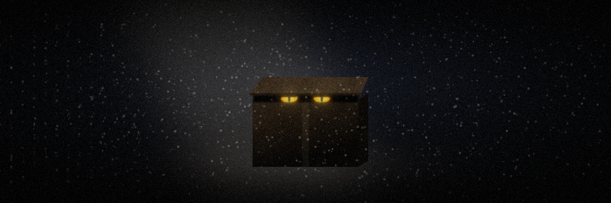

# Merhaba, ben Emirhan

**Yapay zekâ ajanlarıyla yazılım kuruyorum ve nerede patladıklarını ölçüyorum.**

2021'den beri video kurguluyorum. 2022'de yapay zekâ araçları çıkınca Python öğrenmeye başladım, sonra kodu yapay zekâyla birlikte yazmaya geçtim; Temmuz 2022'den beri serbest olarak yapay zekâ işleri yapıyorum. Bugün ajanlarla gerçek işletmelere sistem kuruyorum. Her projede önce neyin asla olmaması gerektiğini yazıyorum, sonra sistemi o hatayı yapana kadar zorluyorum. Patladığı yerleri saklamıyorum.

🌐 **Canlı demolar ve hikâyeler:** [emirhan-karaca.vercel.app](https://emirhan-karaca.vercel.app)

> *EN: I don't write code by hand. I build with AI agents and measure exactly where they fail. Every repo has an English README (`README.en.md`).*

## Öne çıkanlar
| Proje | Ne | Patladığı yer → düzeltme |
|---|---|---|
| [**nobetci**](https://github.com/emirhnnnk-lab/nobetci) | Sessizce ölen işleri yakalayan, bilinen hatayı kendi düzeltip sadece raporlayan ajan sistemi | İlk gerçek gecesinde tanımadığı sebebe kanıtsız "kalıcı" dedi → artık "bilmiyorum" diyor ve kanıt satırını gösteriyor |
| [**destek-talebi-ajani**](https://github.com/emirhnnnk-lab/destek-talebi-ajani) | Talebi anlayan, rutin işleri araçlarla çözen, iade/iptali insana bırakan ajan | Puan 14/16 görünüyordu, araç zinciri aslında 3/16 → 16/16, 5 tekrarın hepsinde 16/16 |
| [**llm-davranis-cerrahisi**](https://github.com/emirhnnnk-lab/llm-davranis-cerrahisi) | Bir modelin içinde davranışların hangi katmanda yaşadığını bulup modeli yönlendirmek | Hakem modeli kör testte güvenilmez çıktı → güvenilir aralığı daralttım |
| [**ytfactory**](https://github.com/emirhnnnk-lab/ytfactory) | Konudan ya da ürün fotoğrafından seslendirilmiş animasyonlu videoya ajan | Aynı model kendi hatasını görmedi → ayrı, daha büyük bir denetçi |
| [**kalkan-akustik-erken-uyari**](https://github.com/emirhnnnk-lab/kalkan-akustik-erken-uyari) | FPV dronları sesinden ve böcek gözüne benzer devrelerle erken fark etmek | Yapay seste çalışan yöntem gerçek kayıtta yazı turaydı (0,54) → 0,89 |

Diğerleri: [müşteri hizmetleri otomasyonu](https://github.com/emirhnnnk-lab/musteri-hizmetleri-otomasyonu) · [doküman asistanı (RAG)](https://github.com/emirhnnnk-lab/kurumsal-dokuman-asistani) · [fatura ayıklayıcı](https://github.com/emirhnnnk-lab/fatura-ayiklayici) · [MCP tedarik zinciri ajanı](https://github.com/emirhnnnk-lab/mcp-tedarik-zinciri-ajani) · [mağaza asistanları](https://github.com/emirhnnnk-lab/ai-magaza-asistanlari) · [reddetme çalışması](https://github.com/emirhnnnk-lab/llm-reddetme-yorumlanabilirlik) · [trading lab](https://github.com/emirhnnnk-lab/risk-first-trading-lab) · [İSG saha portalı](https://github.com/emirhnnnk-lab/isg-saha-portali)

## Nasıl çalışıyorum
- **Önce felaketi yaz:** yanlış bilgi, sızan kişisel veri, onaysız işlem. Başarıdan önce bunları tanımlarım.
- **Kuralı modele emanet etme:** onay, maskeleme, bütçe sınırı kodda durur; model önerir, karar veren kod ve insandır.
- **Ölçmediğine inanma:** her projede bir test seti ve v1 → v2 karşılaştırması var.

## Araçlar
`Claude Code` `Codex` `Ollama` `MCP` `n8n` `Python` `FastAPI` `RAG / ChromaDB` `PyTorch` `Supabase` `Vercel` `GitHub Actions` `Node.js` `Premiere`

📫 emirhnnnk@gmail.com · [LinkedIn](https://www.linkedin.com/in/emirhan-karaca-791733241)
